Souly HR · Módulo de asistencia · Casos para desarrollo

# Casos de Asistencia

- **Versión del módulo:** 1.2
- **Fecha:** 5 de noviembre de 2026
- **Documento del módulo:** modulo-asistencia.html

Cada situación real del módulo en una ficha, para construirla igual que en el prototipo. La ficha dice la situación («Dado que · Cuando · Entonces»), los datos de entrada, lo que calcula el sistema, cómo verlo en la maqueta, dónde está en el código del prototipo y las capturas de la web de RR.HH. y del celular. Las reglas no se repiten aquí: cada ficha nombra las suyas (BR‑ASI) y su pantalla (W‑ASI) del documento del módulo.

## Antes de empezar

- **Dónde:** el prototipo publicado (Vercel) o `npm run dev`. Las pantallas de RR.HH. se ven como **Juan Pérez Gómez · Administrador HR**; las del celular, como **Carlos Mendoza Ríos** (menú lateral › «Ver la demo como»).
- **Datos:** todo sale de la **demo recién cargada** (menú lateral › «Cargar la demo»): FarmaVida S.R.L., 63 colaboradores, reloj en el **viernes 30 de octubre de 2026 a las 16:10**. Si la demo se carga otra semana, los mismos casos caen en otras fechas.
- **Cómo se leen los tiempos:** todo se guarda y se calcula **al segundo**; las pantallas truncan al mostrar (BR‑ASI‑011). En los cálculos, `08:44:24` es la hora exacta de la marca.
- **Las capturas:** salen de la maqueta con `node herramientas/capturas-casos.cjs` (necesita `npm run dev`). Cuando cambia una pantalla, se corre de nuevo y se regenera esta página con `node herramientas/doc-casos.cjs casos-asistencia.md public/casos-asistencia.html`.
- **«En el código»** apunta al prototipo (React). No es el backend: sirve para ver la regla escrita y comparar resultados.

## 1 · La marcación

### CASO-ASI-01 · Marca su entrada desde el celular

- **Reglas:** BR‑ASI‑001, BR‑ASI‑007, BR‑ASI‑010 · W‑ASI‑21
- **Situación:** **Dado que** Carlos trabaja hoy en remoto y su turno empieza a las 08:30 · **Cuando** toca «Marcar entrada» a las 08:27 · **Entonces** ve primero una ventana para confirmar (la hora, si llega a tiempo, dónde marca) y recién después pasa a la ubicación y al rostro.
- **Datos:** Carlos Mendoza Ríos · Oficina 08:30–18:00 · Híbrido (oficina martes y jueves) · viernes 30 oct = remoto.
- **Calcula:** `remoto → no se revisa la geocerca; la ubicación queda solo como registro`
  `hora de la marca = la del servidor, al segundo (no la del celular)`
- **Para probarlo:** como Carlos › celular › Inicio › «Marcar entrada».
- **En el código:** `components/asistencia/Marcador.jsx` (los pasos), `context/AsistenciaContext.jsx › marcar()`.
- **Qué mirar:** la ventana de confirmar va antes de escanear; en remoto dice «no se revisa la oficina».
- 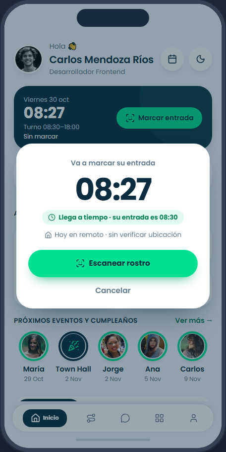
- 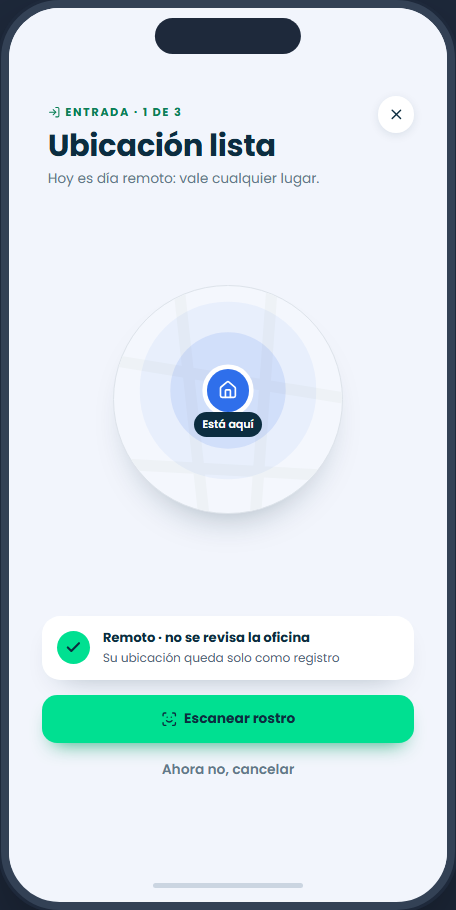

### CASO-ASI-02 · Marca lejos de su lugar: la marca se rechaza

- **Reglas:** BR‑ASI‑003, BR‑ASI‑004 · W‑ASI‑07
- **Situación:** **Dado que** Diego debe marcar en Casa Matriz Equipetrol · **Cuando** marca su entrada a 401 m del lugar · **Entonces** la marca queda **rechazada, a la vista**, y no cuenta; la que vale es la siguiente, ya dentro.
- **Datos:** Diego Morales · 08:30–18:00 · martes 6 oct · Entrada 08:18:48 a 401 m (rechazada) · Entrada 08:24:48 a 57 m · Salida 19:21:03.
- **Calcula:** `401 m > radio de la geocerca → rechazada (no cuenta)`
  `entrada del día = 08:24:48 (la primera válida) → a tiempo`
- **Para probarlo:** Asistencia › Libro › buscar a Diego › martes 6 oct (o su página › octubre › 6).
- **En el código:** `context/AsistenciaContext.jsx › marcar()` (campo `dentro`), `data/asistenciaData.js › recomputar()` (filtra las rechazadas).
- **Qué mirar:** la fila roja «Rechazada · fuera de la geocerca» con su distancia; ese mismo día también muestra «No marcó su descanso» y «1 h 26 min fuera de horario».
- 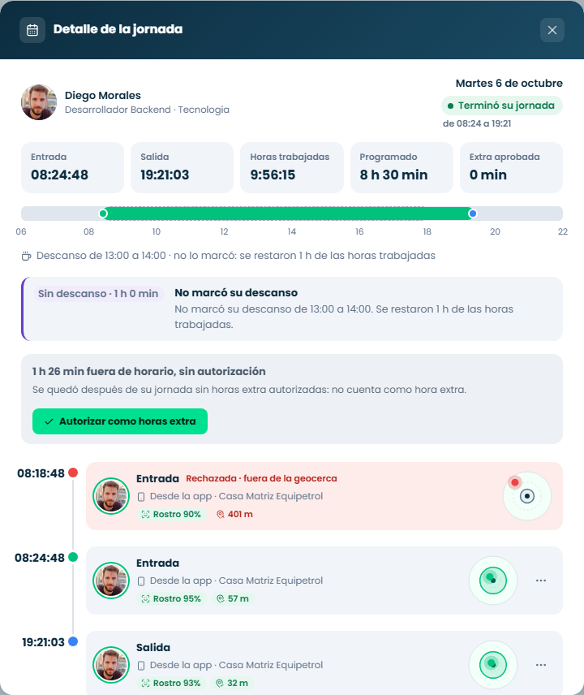

### CASO-ASI-03 · El rostro no coincide

- **Reglas:** BR‑ASI‑005, BR‑ASI‑006 · W‑ASI‑07
- **Situación:** **Dado que** la empresa pide un mínimo de parecido del rostro · **Cuando** Tomás marca y el rostro da 51 % · **Entonces** la marca se rechaza; marca de nuevo 90 segundos después con 92 % y esa vale.
- **Datos:** Tomás Ibáñez · Sucursal Montero · 07:00–15:00 · lunes 5 oct · Entrada 06:49:20 rostro 51 % (rechazada) · Entrada 06:50:50 rostro 92 %.
- **Calcula:** `51 % < mínimo de la empresa → rechazada`
  `entrada del día = 06:50:50 → a tiempo`
- **Para probarlo:** página de Tomás Ibáñez › octubre › 5.
- **En el código:** `components/asistencia/DetalleJornada.jsx` (cómo se muestra), `data/asistenciaData.js › recomputar()`.
- **Qué mirar:** la marca rechazada sigue en la lista con su porcentaje; no se borra.
- 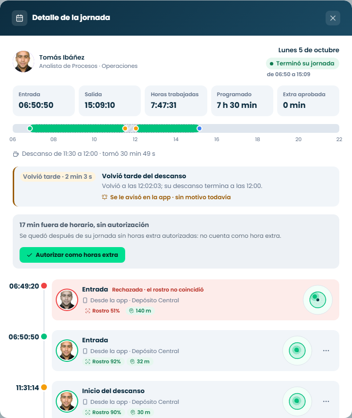

### CASO-ASI-04 · El celular tiene otra hora

- **Reglas:** BR‑ASI‑001, BR‑ASI‑002
- **Situación:** **Dado que** el reloj del celular de alguien está 20 minutos atrasado · **Cuando** marca su entrada a las 08:41 reales · **Entonces** la marca queda a las 08:41: la hora la pone el servidor.
- **Datos:** cualquier persona; el celular manda tipo de marca, ubicación y rostro, **nunca la hora**.
- **Calcula:** `marca.min = hora del servidor al recibirla, al segundo`
- **Para probarlo:** no se ve en la maqueta (todo corre en el mismo equipo). Se prueba con el backend: cambiar la hora del celular y marcar.
- **En el código:** `context/AsistenciaContext.jsx › marcar()` — `min: alSegundo(minutosAhora())`.
- **Qué mirar:** sin captura: es una regla del servidor.

## 2 · El cálculo del día

### CASO-ASI-05 · Llega dentro de la tolerancia

- **Reglas:** BR‑ASI‑012, BR‑ASI‑050 · W‑ASI‑07
- **Situación:** **Dado que** Camila entra a las 09:00 con 10 min de tolerancia · **Cuando** marca a las 09:05:48 · **Entonces** el día queda **a tiempo**, sin tardanza.
- **Datos:** Camila Herrera · Sucursal Sopocachi · 09:00–17:00 · martes 27 oct · Entrada 09:05:48.
- **Calcula:** `límite = 09:00 + 10 min = 09:10:00`
  `09:05:48 ≤ 09:10:00 → tardanza 0 → a tiempo`
- **Para probarlo:** página de Camila Herrera › octubre › 27.
- **En el código:** `data/asistenciaData.js › recomputar()` — `tardanza`.
- **Qué mirar:** sin aviso de tardanza, aunque entró después de las 09:00.
- 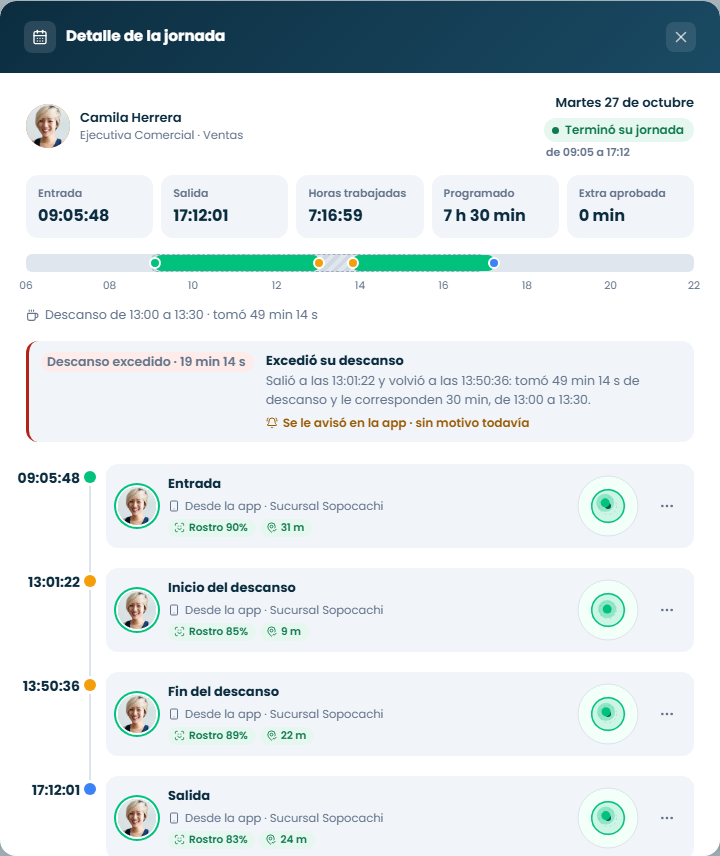

### CASO-ASI-06 · Llega tarde

- **Reglas:** BR‑ASI‑012, BR‑ASI‑050 · W‑ASI‑07
- **Situación:** **Dado que** Diego entra a las 08:30 con 10 min de tolerancia · **Cuando** marca a las 08:44:24 · **Entonces** llegó **4 min 24 s tarde**: la tardanza se cuenta desde el fin de la tolerancia, no desde las 08:30.
- **Datos:** Diego Morales · 08:30–18:00 · jueves 15 oct · Entrada 08:44:24 · Descanso 13:01:31–13:57:43 · Salida 17:56:18.
- **Calcula:** `tardanza = 08:44:24 − (08:30 + 10 min) = 4 min 24 s`
  `trabajado = (17:56:18 − 08:44:24) − 56 min 12 s de descanso = 8 h 15 min 42 s`
- **Para probarlo:** página de Diego Morales › octubre › 15.
- **En el código:** `data/asistenciaData.js › recomputar()` — una sola tardanza; todas las pantallas leen esta.
- **Qué mirar:** «Llegó tarde · 4 min tarde» arriba, la tarjeta Tardanza «4 min 24 s» y la línea «Se le avisó en la app · sin motivo todavía».
- 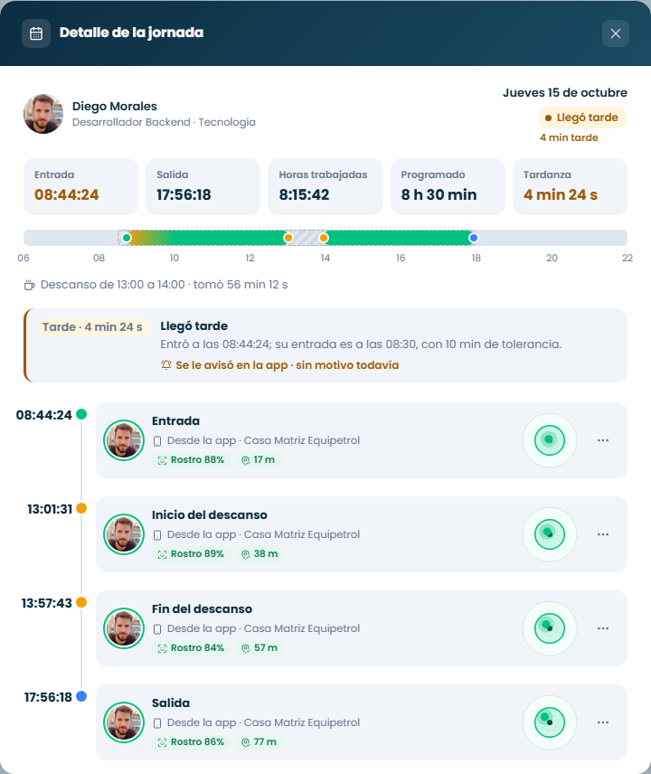

### CASO-ASI-07 · Olvida marcar la salida

- **Reglas:** BR‑ASI‑018, BR‑ASI‑021 · W‑ASI‑07
- **Situación:** **Dado que** Camila marcó su entrada · **Cuando** se va sin marcar la salida · **Entonces** el día queda **«Salida sin marcar»** (incompleto) y no suma horas hasta que se corrija.
- **Datos:** Camila Herrera · sábado 10 oct · 09:00–13:00 · Entrada 08:53:38 · sin más marcas.
- **Calcula:** `sin salida y el día ya pasó → estado incompleta`
  `trabajado = 0 (no hay fin para calcular)`
- **Para probarlo:** página de Camila Herrera › octubre › 10.
- **En el código:** `data/asistenciaData.js › recomputar()` — `estado = 'incompleta'`.
- **Qué mirar:** el estado «Salida sin marcar» y las horas en cero; se arregla con una corrección (CASO‑ASI‑16).
- 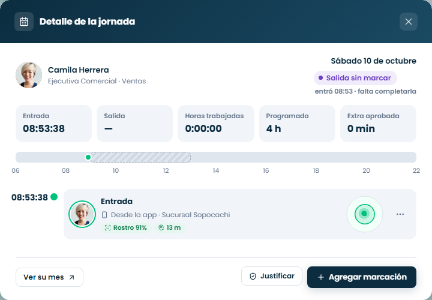

### CASO-ASI-08 · Se pasa del descanso

- **Reglas:** BR‑ASI‑014, BR‑ASI‑015 · W‑ASI‑07
- **Situación:** **Dado que** Diego tiene 1 h de descanso, de 13:00 a 14:00 · **Cuando** sale a las 13:01:33 y vuelve a las 14:27:22 · **Entonces** se alerta **una vez** el exceso, que se cuenta en tiempo.
- **Datos:** Diego Morales · miércoles 21 oct · Entrada 08:18:16 · Descanso 13:01:33–14:27:22 · Salida 18:08:41.
- **Calcula:** `descanso tomado = 14:27:22 − 13:01:33 = 1 h 25 min 49 s`
  `exceso = 1 h 25 min 49 s − 1 h = 25 min 49 s`
- **Para probarlo:** página de Diego Morales › octubre › 21.
- **En el código:** `data/asistenciaData.js › recomputar()` — `pausaExceso`.
- **Qué mirar:** el aviso dice a qué hora salió y volvió y cuánto le corresponde.
- 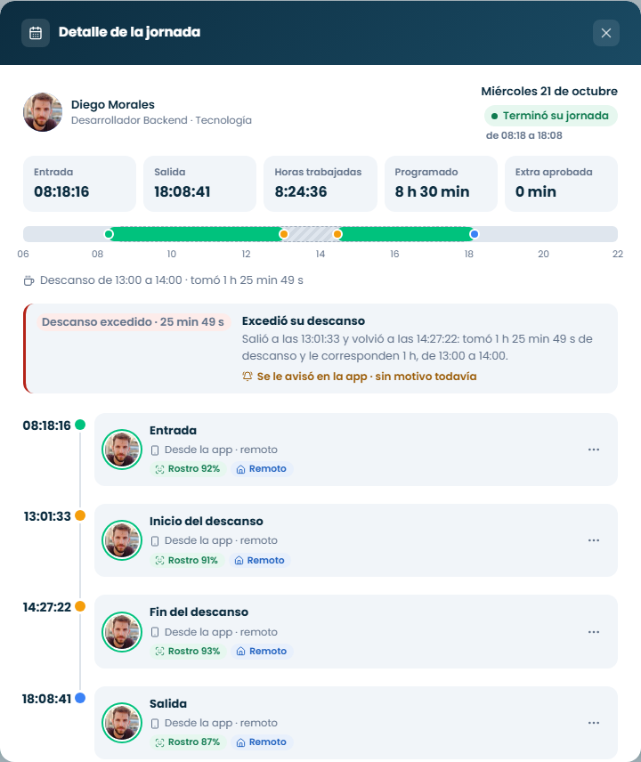

### CASO-ASI-09 · No marca el descanso

- **Reglas:** BR‑ASI‑016, BR‑ASI‑022 · W‑ASI‑07
- **Situación:** **Dado que** Camila tiene 30 min de descanso, de 13:00 a 13:30 · **Cuando** marca solo la entrada y la salida · **Entonces** se restan los 30 min de lo trabajado y se le avisa.
- **Datos:** Camila Herrera · miércoles 21 oct · 09:00–17:00 · Entrada 08:57:32 · Salida 17:10:16.
- **Calcula:** `trabajado = (17:10:16 − 08:57:32) − 30 min = 7 h 42 min 44 s`
- **Para probarlo:** página de Camila Herrera › octubre › 21.
- **En el código:** `data/asistenciaData.js › recomputar()` — `sinPausa` (según la política: descontar, alertar o las dos).
- **Qué mirar:** «No marcó su descanso de 13:00 a 13:30. Se restaron 30 min de las horas trabajadas».
- 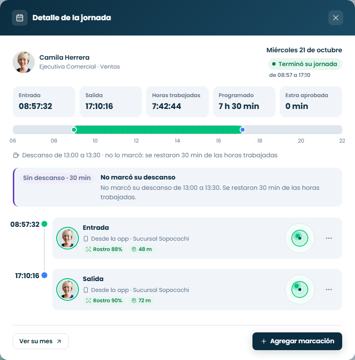

### CASO-ASI-10 · Se queda más de 30 minutos sin autorización

- **Reglas:** BR‑ASI‑032, BR‑ASI‑034 · W‑ASI‑07
- **Situación:** **Dado que** Diego no tiene horas extra autorizadas ese día · **Cuando** se queda hasta las 19:55:58 · **Entonces** lo de más es **«fuera de horario»**: se informa, no se paga. RR.HH. puede autorizarlo después.
- **Datos:** Diego Morales · jueves 22 oct · 08:30–18:00 (8 h 30 min) · Entrada 08:25:02 · Descanso 13:00:38–13:59:21 · Salida 19:55:58.
- **Calcula:** `trabajado = 10 h 32 min 13 s · programado = 8 h 30 min · autorizado = 0`
  `fuera de horario = 10 h 32 min 13 s − 8 h 30 min = 2 h 2 min 13 s (≥ 15 min → se informa)`
  `en el tema «Fuera de horario» del Libro aparece si es ≥ 30 min`
- **Para probarlo:** página de Diego Morales › octubre › 22.
- **En el código:** `data/asistenciaData.js › recomputar()` — `fueraDeHorario`.
- **Qué mirar:** el bloque «fuera de horario, sin autorización» con el botón «Autorizar como horas extra».
- 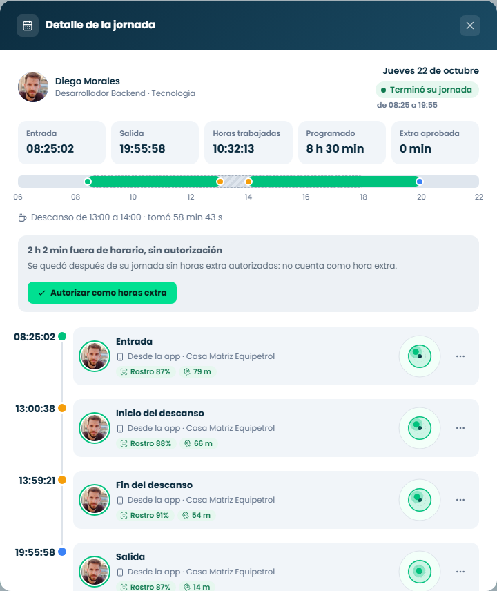

### CASO-ASI-11 · Sale antes de hora

- **Reglas:** BR‑ASI‑017 · W‑ASI‑07
- **Situación:** **Dado que** la salida de Camila es a las 17:00 · **Cuando** marca la salida a las 16:11:08 · **Entonces** el día queda **«Salió antes»**, pasada su tolerancia de salida.
- **Datos:** Camila Herrera · lunes 19 oct · 09:00–17:00 · Entrada 08:48:15 · Descanso 13:01:09–13:27:45 · Salida 16:11:08.
- **Calcula:** `salida anticipada = 17:00 − tolerancia de salida − 16:11:08`
- **Para probarlo:** página de Camila Herrera › octubre › 19.
- **En el código:** `data/asistenciaData.js › recomputar()` — `anticipada`.
- **Qué mirar:** el aviso «Salió a las 16:11:08; su salida es a las 17:00».
- 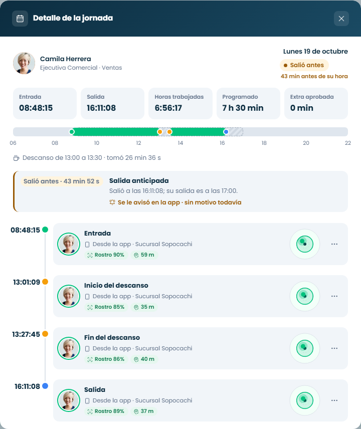

### CASO-ASI-12 · Falta sin aviso

- **Reglas:** BR‑ASI‑018, BR‑ASI‑026 · W‑ASI‑07
- **Situación:** **Dado que** Valentina tenía que trabajar · **Cuando** no marca nada y no tiene permiso · **Entonces** el día queda **«Faltó»** y cuenta en contra hasta que se justifique.
- **Datos:** Valentina Cruz · viernes 9 oct · 08:30–18:00 · sin marcas · sin vacaciones ni permiso.
- **Calcula:** `día laboral, pasado, sin entrada, sin justificación → ausente`
  `programado = 8 h 30 min (sí cuenta)`
- **Para probarlo:** página de Valentina Cruz › octubre › 9.
- **En el código:** `data/asistenciaData.js › recomputar()` — `estado = 'ausente'`.
- **Qué mirar:** desde el detalle se justifica el día (BR‑ASI‑026); justificado deja de ser falta.
- 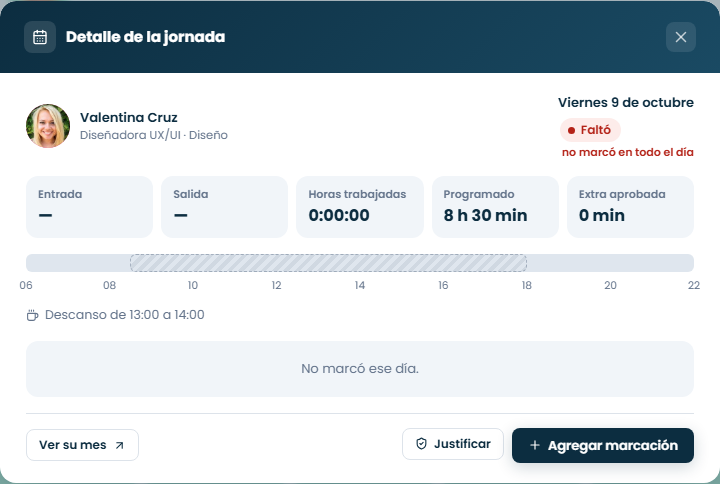

### CASO-ASI-13 · Día de vacaciones

- **Reglas:** BR‑ASI‑039 · W‑ASI‑07
- **Situación:** **Dado que** Sofía tiene vacaciones aprobadas · **Cuando** no marca · **Entonces** el día no es falta, **no se la espera** en Hoy y **no tiene horas programadas**.
- **Datos:** Sofía Ramírez · miércoles 28 oct · vacaciones aprobadas «Viaje familiar».
- **Calcula:** `con justificación y sin entrada → justificada`
  `programado = 0 (no le «faltan» horas a quien está de vacaciones)`
- **Para probarlo:** página de Sofía Ramírez › octubre › 28.
- **En el código:** `data/asistenciaData.js › recomputar()` — `programado: estado === 'justificada' ? 0 : programado`.
- **Qué mirar:** el día dice de qué es la ausencia, no «Faltó».
- 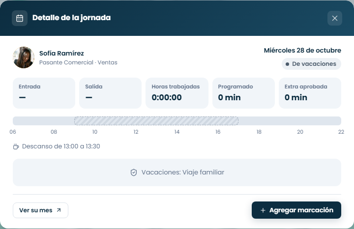

### CASO-ASI-14 · Feriado nacional

- **Reglas:** BR‑ASI‑019 · W‑ASI‑01
- **Situación:** **Dado que** el 2 de noviembre es Todos Santos · **Cuando** nadie marca ese día · **Entonces** nadie figura como falta.
- **Datos:** feriado nacional 2 nov 2026 «Todos Santos» (también 25 dic, Navidad).
- **Calcula:** `feriado → día no laboral → sin programado, sin faltas`
- **Para probarlo:** Asistencia › Hoy › calendario › mes siguiente › 2.
- **En el código:** `data/asistenciaData.js › FERIADOS`, `components/asistencia/CalendarioAsistencia.jsx`.
- **Qué mirar:** el punto violeta de feriado y el detalle «Feriado nacional: nadie debería figurar como falta».
- 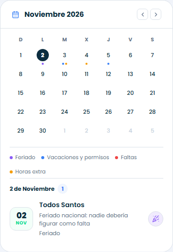

## 3 · Corregir sin borrar

### CASO-ASI-15 · Pide corregir una hora y RR.HH. la aprueba

- **Reglas:** BR‑ASI‑023, BR‑ASI‑037, BR‑ASI‑038 · W‑ASI‑22, W‑ASI‑10
- **Situación:** **Dado que** Diego marcó la salida a las 18:12 pero se fue a las 18:22 · **Cuando** pide corregirla desde el celular y RR.HH. aprueba · **Entonces** su salida queda a las 18:22 **sobre la misma marca** (sin una nueva), con la hora original guardada y el motivo.
- **Datos:** Diego Morales · 08:30–18:00 · jueves 29 oct · Salida 18:12 → 18:22 · «La app tardó en registrar mi salida» · es su 3.ª corrección del mes.
- **Calcula:** `suma 9 min trabajadas (la marca original tenía segundos pasadas las 18:12)`
  `mueve ≤ 15 min, pero es su 3.ª corrección del mes → se revisa de a una, no en lote`
  `aprobar → ajustar(marcaId, 18:22, motivo): original = 18:12`
- **Para probarlo:** celular: Mi asistencia › «+» › «Corregir una marcación». Web: Solicitudes › Correcciones de marcación › Diego, 29 oct.
- **En el código:** `components/asistencia/Marcador.jsx › CorregirMarcaCel`, `components/asistencia/PapeletaCorreccion.jsx`, `context/AsistenciaContext.jsx › responderSolicitud()`, `utils/correccion.js`.
- **Qué mirar:** en la papeleta, la hora vieja tachada y la nueva en verde; abajo, «Suma 9 min trabajadas · Es su 3.ª corrección del mes»; «Si apruebas» dice que se corrige sin duplicar.
- 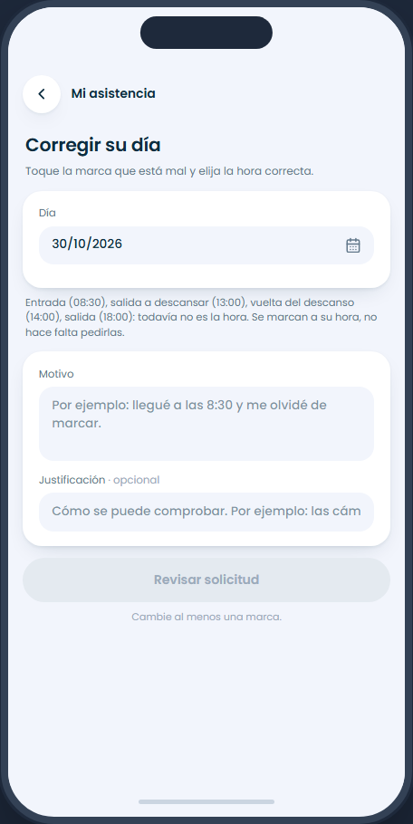
- 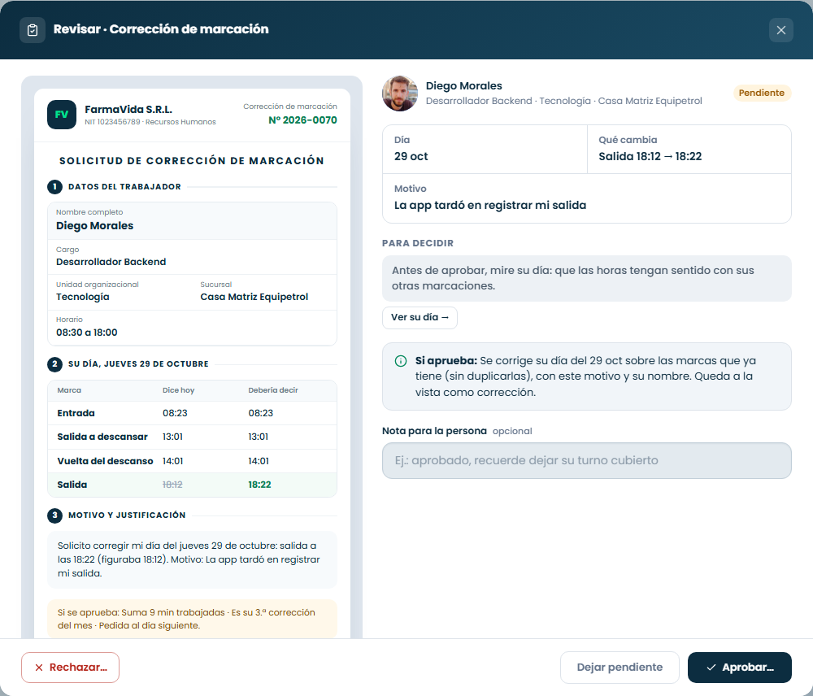

### CASO-ASI-16 · Carga una marca que faltaba

- **Reglas:** BR‑ASI‑023, BR‑ASI‑038 · W‑ASI‑10
- **Situación:** **Dado que** Luciana no marcó su salida a descansar · **Cuando** pide cargarla a las 13:00 · **Entonces** al aprobar se agrega **una marca nueva** con su motivo (es la única corrección que agrega una marca).
- **Datos:** Luciana Paredes · Sucursal El Prado · 09:00–17:00 · jueves 29 oct · Entrada 08:50 · pide «Salida a descansar 13:00» · «Me olvidé de marcar» · es su 3.ª corrección del mes.
- **Calcula:** `marca sin marcaId → aprobar = marcaManual(13:00, motivo)`
  `3.ª corrección del mes → no es rutinaria: se revisa de a una`
- **Para probarlo:** Solicitudes › Correcciones de marcación › Luciana Paredes, 29 oct.
- **En el código:** `context/AsistenciaContext.jsx › responderSolicitud()`, `utils/correccion.js › ranurasDelDia()` (la hora sugerida).
- **Qué mirar:** en la papeleta, «Sin marcar» → «13:00»; abajo, «Es su 3.ª corrección del mes».
- 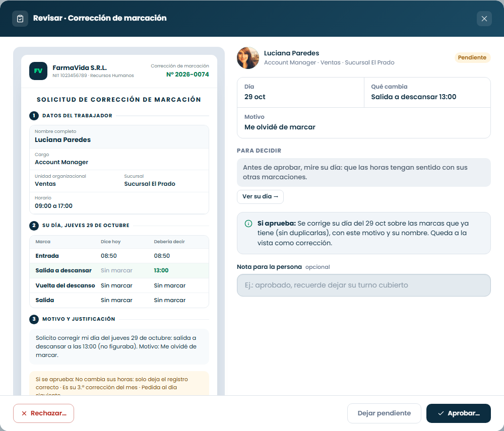

### CASO-ASI-17 · Quita una marca de más

- **Reglas:** BR‑ASI‑024 · W‑ASI‑10
- **Situación:** **Dado que** Fernando marcó dos veces la entrada · **Cuando** pide quitar la de las 08:25 · **Entonces** al aprobar esa marca queda **anulada, a la vista**: no se borra.
- **Datos:** Fernando Quisbert · Sucursal Montero · 08:30–18:00 · jueves 29 oct · Entrada 08:24 · Entrada de más 08:25 · «La app me hizo marcar de nuevo».
- **Calcula:** `aprobar → anular(marcaId, motivo)`
  `no cambia sus horas: la entrada del día sigue siendo 08:24`
- **Para probarlo:** Solicitudes › Correcciones de marcación › Fernando Quisbert, 29 oct.
- **En el código:** `context/AsistenciaContext.jsx › responderSolicitud()` (`c.quitar → anular`).
- **Qué mirar:** la fila «Entrada de más 08:25 → Se quita».
- 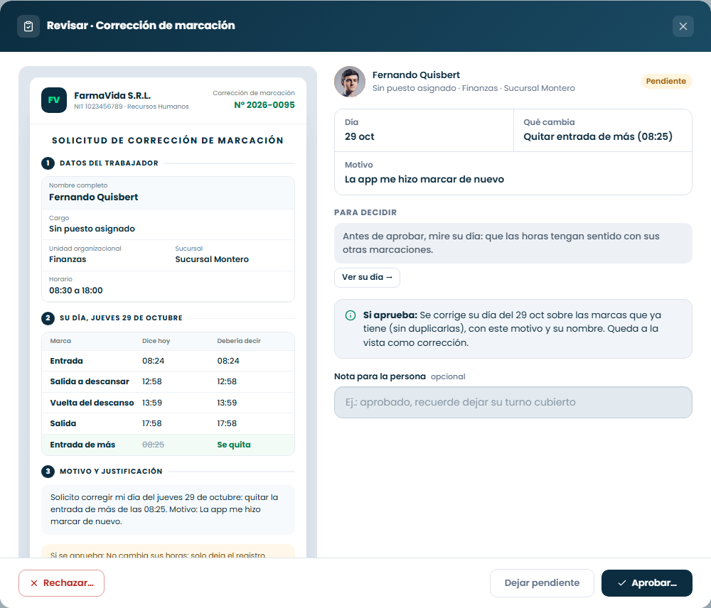

### CASO-ASI-18 · RR.HH. carga una marca a mano

- **Reglas:** BR‑ASI‑025 · W‑ASI‑02
- **Situación:** **Dado que** alguien no pudo marcar · **Cuando** RR.HH. carga la marca a mano · **Entonces** **sin motivo no se guarda**, y la marca queda como «Cargada por RR.HH.» con quién y cuándo.
- **Datos:** cualquier colaborador; hora y motivo obligatorios.
- **Calcula:** `marca { origen: 'panel', motivo, por, cuando }`
- **Para probarlo:** Asistencia › Hoy › «Marcación manual».
- **En el código:** `pages/asistencia/Hoy.jsx`, `context/AsistenciaContext.jsx › marcaManual()`.
- **Qué mirar:** primero se elige a la persona; después la hora y el motivo, que es obligatorio y queda en el registro.
- 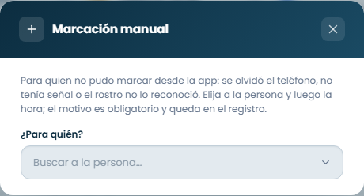

### CASO-ASI-19 · RR.HH. aprueba correcciones en lote

- **Reglas:** BR‑ASI‑038, BR‑ASI‑054 · W‑ASI‑09
- **Situación:** **Dado que** hay 123 correcciones pendientes · **Cuando** RR.HH. abre «Revisar en lote», elige las rutinarias y escribe APROBAR · **Entonces** se aprueban todas juntas, cada una igual que aprobada de a una.
- **Datos:** 123 pendientes en la demo: 97 rutinarias y 26 de a una.
- **Calcula:** `rutinaria = mueve ≤ 15 min · no quita atraso · 1.ª o 2.ª del mes · no es la propia`
  `lo demás → «Se revisan de a una», con el porqué`
- **Para probarlo:** Solicitudes › Correcciones de marcación › «Revisar en lote».
- **En el código:** `pages/asistencia/RevisarLote.jsx`, `utils/correccion.js › pideRespaldo()`.
- **Qué mirar:** «Ver su día» abre las marcas de ese día; el pie fijo pide escribir APROBAR. Rechazar no va en lote: cada rechazo lleva su motivo.
- 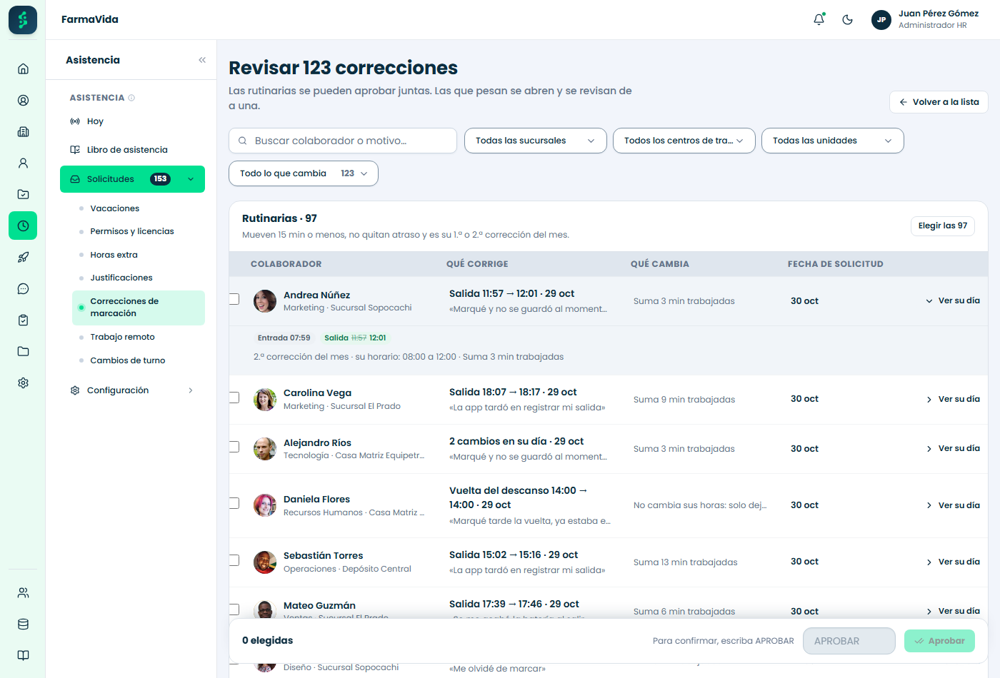

## 4 · Justificaciones y solicitudes

### CASO-ASI-20 · Justifica una tardanza

- **Reglas:** BR‑ASI‑028, BR‑ASI‑029 · W‑ASI‑10
- **Situación:** **Dado que** Mateo llegó 36 min 47 s tarde · **Cuando** lo justifica desde la app («Llovió fuerte y no había transporte») y RR.HH. acepta · **Entonces** la tardanza **deja de contar en contra** en el resumen y en la puntualidad.
- **Datos:** Mateo Guzmán · Sucursal El Prado · jueves 29 oct · llegó tarde 36 min 47 s · categoría Clima · respondió al aviso el 30 oct.
- **Calcula:** `aceptada → justificadas.tarde = {...} → tardanzaInjustificada = 0`
- **Para probarlo:** Solicitudes › Justificaciones › Mateo Guzmán.
- **En el código:** `components/asistencia/RevisarSolicitud.jsx`, `data/asistenciaData.js › recomputar()` (`justificadas`).
- **Qué mirar:** «Primera justificación del mes» y «Si apruebas» con el efecto.
- 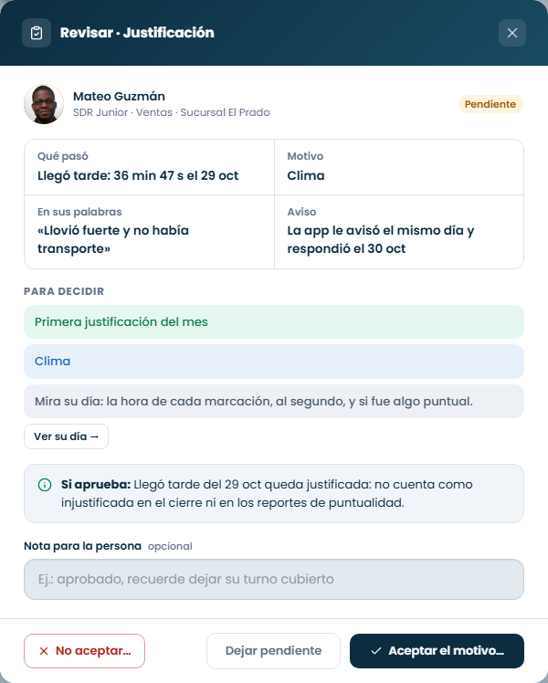

### CASO-ASI-21 · Pide horas extra y solo cuenta lo autorizado

- **Reglas:** BR‑ASI‑032, BR‑ASI‑033 · W‑ASI‑22, W‑ASI‑12, W‑ASI‑07
- **Situación:** **Dado que** Diego tiene autorizadas horas extra de 18:00 a 20:00 · **Cuando** se queda hasta las 20:06:28 · **Entonces** cuentan como extra **solo las 2 h dentro de la ventana**; los 6 min de después no se pagan.
- **Datos:** Diego Morales · miércoles 7 oct · 08:30–18:00 · Entrada 08:31:52 · Descanso 12:59:22–13:59:19 · Salida 20:06:28 · ventana 18:00–20:00. Pendiente en la demo: 31 oct 18:00–20:00 «Cobertura por vacaciones».
- **Calcula:** `extra = lo trabajado dentro de 18:00–20:00 = 2 h`
  `sobra = 10 h 34 min 39 s − 8 h 30 min − 2 h = 4 min 39 s (< 15 min → no es fuera de horario)`
- **Para probarlo:** celular: Mi asistencia › «+» › «Pedir horas extra». Web: Solicitudes › Horas extra; el día, en la página de Diego › octubre › 7.
- **En el código:** `pages/asistencia/HorasExtra.jsx`, `data/asistenciaData.js › recomputar()` — `extra` y `ventanas`.
- **Qué mirar:** «Solo cuentan las autorizadas. Quedarse más tiempo no las genera».
- 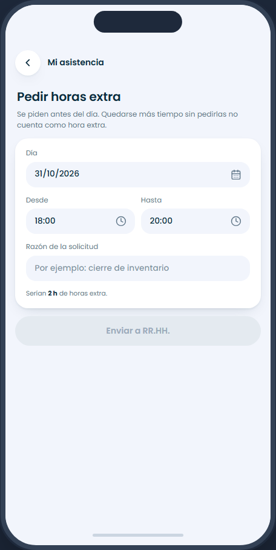
- 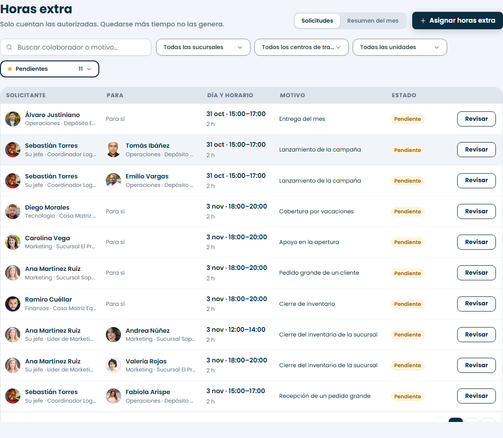
- 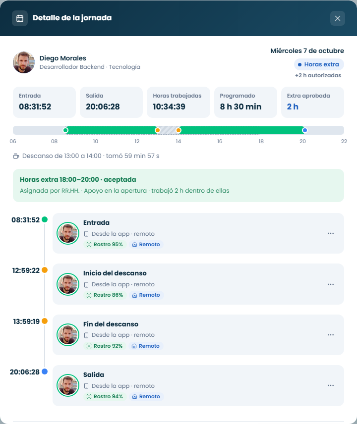

### CASO-ASI-22 · Pide vacaciones sin saldo

- **Reglas:** BR‑ASI‑041, BR‑ASI‑042, BR‑ASI‑043 · W‑ASI‑10
- **Situación:** **Dado que** Camila aún no cumple un año (saldo 0) · **Cuando** pide 4 días · **Entonces** RR.HH. ve que no le alcanza y que su lugar sigue cubierto; aprobar es **una excepción** y queda registrada así.
- **Datos:** Camila Herrera · ingreso 2 ene 2026 · del 5 al 9 nov · 4 días hábiles · «Viaje» · Sucursal Sopocachi con 10 de 12.
- **Calcula:** `días hábiles = jue 5, vie 6, sáb 7, lun 9 = 4 (trabaja de lunes a sábado; el domingo no cuenta) · saldo después = 0 − 4 = −4`
  `cobertura = 10 de 12 → sigue cubierto`
- **Para probarlo:** Solicitudes › Vacaciones › Camila Herrera.
- **En el código:** `components/asistencia/RevisarSolicitud.jsx`, `utils/papeletaVacacion.js`.
- **Qué mirar:** el botón dice «Aprobar igual…» en vez de «Aprobar…»; la papeleta muestra «Saldo después −4 días (de 0)».
- 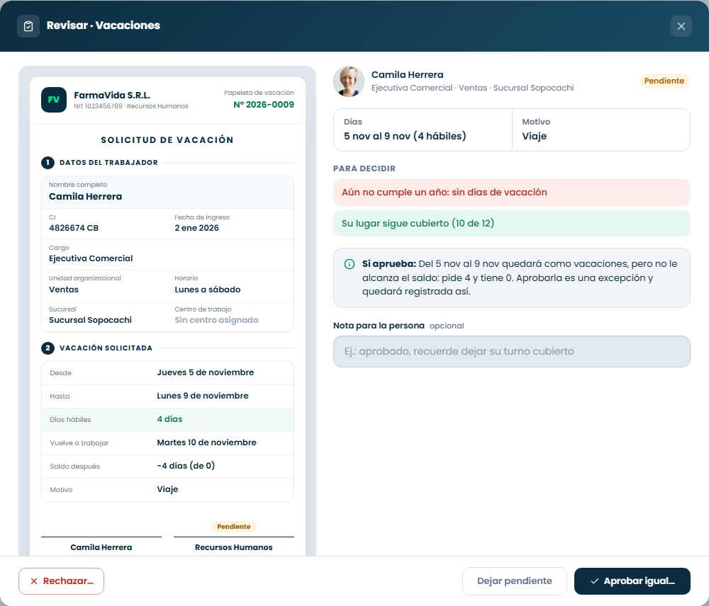

### CASO-ASI-23 · Permiso por horas

- **Reglas:** BR‑ASI‑040 · W‑ASI‑10
- **Situación:** **Dado que** Valentina pide permiso de 15:00 a 17:00 para una cita médica · **Cuando** RR.HH. lo aprueba · **Entonces** puede ausentarse esas horas, pero **el resto del día lo trabaja**: un permiso por horas no justifica el día entero.
- **Datos:** Valentina Cruz · sábado 31 oct · 15:00–17:00 · Cita médica · «Control médico».
- **Calcula:** `permiso por horas → justifica solo 15:00–17:00, no el día`
- **Para probarlo:** Solicitudes › Permisos y licencias › Valentina Cruz.
- **En el código:** `utils/permisoHoras.js`, `utils/papeletaPermiso.js`.
- **Qué mirar:** «Si apruebas: Podrá ausentarse de 15:00 a 17:00 el 31 oct».
- 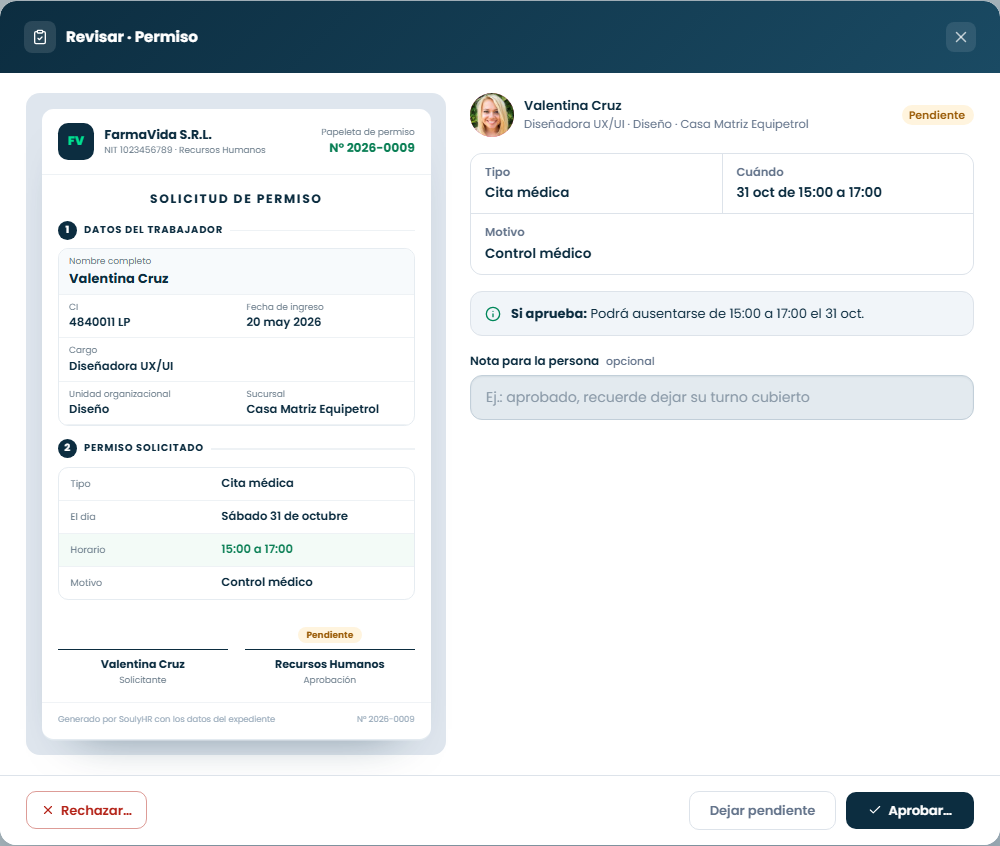

## 5 · Lo que ve la persona

### CASO-ASI-24 · Su celular y la web dicen lo mismo

- **Reglas:** BR‑ASI‑057 · W‑ASI‑22, W‑ASI‑06
- **Situación:** **Dado que** RR.HH. mira el mes de Carlos en la web (y su PDF) · **Cuando** Carlos mira su mes en el celular · **Entonces** los dos dicen los mismos números.
- **Datos:** Carlos Mendoza Ríos · septiembre 2026 · 17 días con entrada, 4 llegadas tarde, 1 falta, 4 días de vacaciones o permiso.
- **Calcula:** `trabajado = 137 h 41 min (web «137:41», celular «137 h 41 min»)`
  `días a tiempo = días que vino sin llegar tarde ÷ días que vino = 13 de 17`
  `puntualidad = 13 ÷ 17 = 76 % · llegadas tarde = 4`
  `las vacaciones y los permisos no cuentan en ninguno de los dos lados`
- **Para probarlo:** web: página de Carlos › septiembre. Celular (como Carlos): Mi asistencia › «Ver el mes» › septiembre.
- **En el código:** `utils/cifrasMes.js › cifrasDelMes()`, usado por `ReporteMes.jsx` (PDF) y `Marcador.jsx` (celular).
- **Qué mirar:** el celular y la web cuentan igual. Ojo: el historial de ejemplo de Carlos (sus vacaciones) se siembra la primera vez que se entra a la demo como él.
- 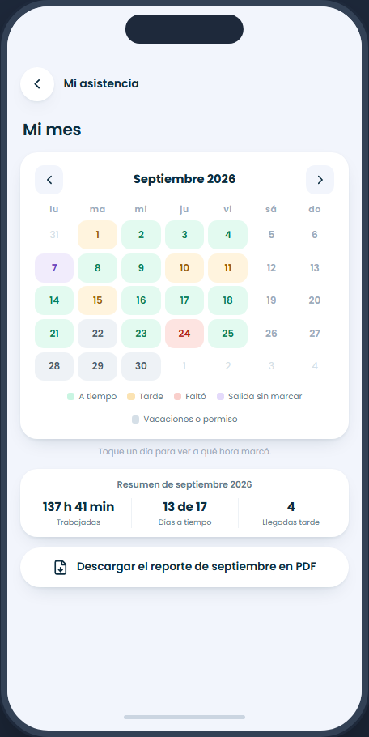
- 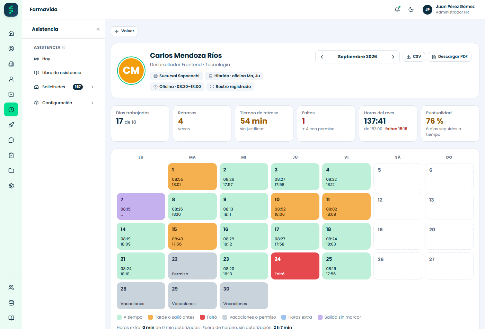

## 6 · Horas extra y el pedido del jefe

### CASO-ASI-25 · RR.HH. revisa horas extra con su papeleta y su día

- **Reglas:** BR‑ASI‑032, BR‑ASI‑033 · W‑ASI‑12
- **Situación:** **Dado que** Ana pidió horas extra para el martes 3 de noviembre de 18:00 a 20:00 · **Cuando** RR.HH. la revisa · **Entonces** ve la papeleta (como en Vacaciones), la barra de su día con la franja en violeta y lo que hace falta para decidir.
- **Datos:** Ana Martínez Ruiz · Líder de Marketing · Sucursal Sopocachi · 08:30–18:00 · mar 3 nov · 18:00–20:00 · «Pedido grande de un cliente» · Inventario anual.
- **Calcula:** `horas = 20:00 − 18:00 = 2 h`
  `hueco = 18:00 (desde) − 18:00 (su salida) = 0 → «Empiezan justo cuando termina su horario»`
  `del mes = autorizadas (aprobadas o aceptadas) del mismo mes → «Primera vez en noviembre»`
  `si ese día no trabaja (un sábado de alguien de lunes a viernes) → «El sábado no trabaja: las horas extra serían en su día libre»`
- **Para probarlo:** Solicitudes › Horas extra › Ana Martínez Ruiz › Revisar.
- **En el código:** `components/asistencia/PapeletaExtra.jsx`, `pages/asistencia/HorasExtra.jsx` (el bloque «Revisar»), `components/asistencia/comunes.jsx › BarraDia` (`ventanas`).
- **Qué mirar:** «Solicitante: Ana Martínez Ruiz · para sí» en la papeleta; la barra rayada es su horario y la violeta, lo que pide; «Si aprueba» habla de usted.
- 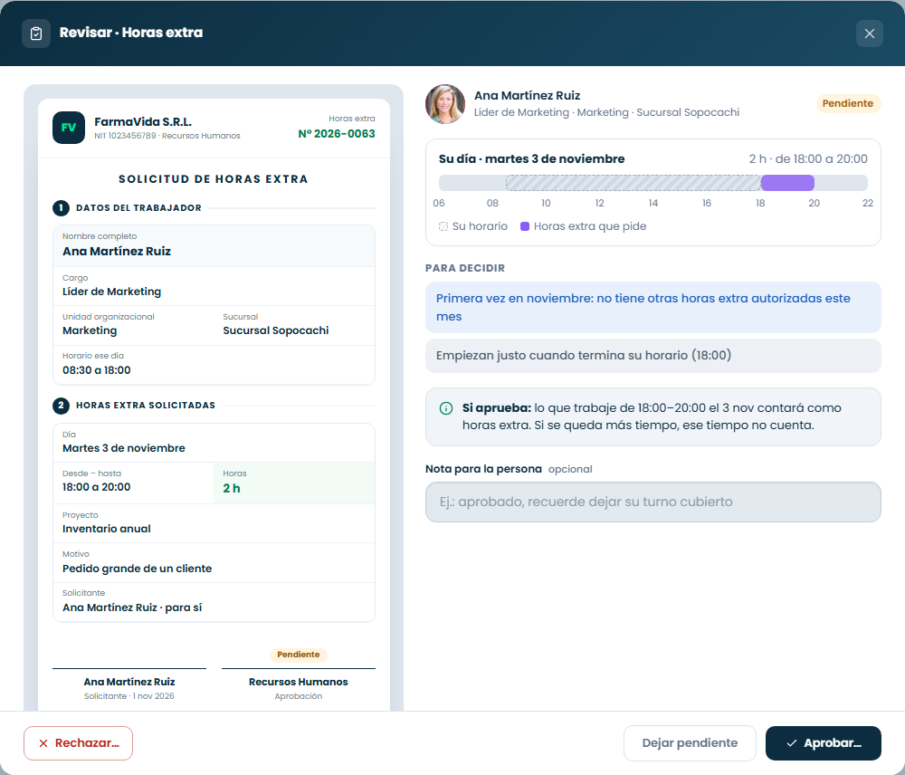

### CASO-ASI-26 · El jefe pide horas extra para dos de su equipo

- **Reglas:** BR‑ASI‑059, BR‑ASI‑033 · W‑ASI‑24, W‑ASI‑12
- **Situación:** **Dado que** Sebastián Torres coordina Operaciones · **Cuando** pide horas extra para Tomás Ibáñez y Emilio Vargas · **Entonces** RR.HH. recibe una solicitud por persona; al aprobar, cada uno las acepta o dice que no puede en su celular. Recién aceptadas cuentan.
- **Datos:** Sebastián Torres (Coordinador Logístico) → Tomás Ibáñez y Emilio Vargas · sáb 31 oct · 15:00–17:00 (su salida es 15:00) · «Lanzamiento de la campaña». En el celular, Ana Martínez (líder de Marketing) elige a Natalia Ferrer y Bruno Salazar.
- **Calcula:** `pedido del jefe → una solicitud por persona { origen: lider, lider, grupo }`
  `RR.HH. aprueba → estado asignada (Por aceptar): todavía no cuenta`
  `la persona toca «Acepto» → aceptada (cuenta) · «No puedo» → rechazada, con noPudo`
- **Para probarlo:** celular: «Ver la demo como» › Líder de Área Mobile — Marketing › Mi asistencia › «+» › «Pedir horas extra para mi equipo» (también en Mis solicitudes › ¿Qué necesita?). Web: Solicitudes › Horas extra › una fila «Su jefe».
- **En el código:** `components/asistencia/Marcador.jsx › PedirExtraCel` (`equipo`), `hooks/useEquipo.js`, `context/AsistenciaContext.jsx › responderExtra()`, `components/asistencia/PapeletaExtra.jsx` (tres firmas).
- **Qué mirar:** el «+» suma la opción solo para el líder; «Para quién» con varias personas; en RR.HH., «Lo pidió su jefe, Sebastián Torres, para 2 personas…» y «Si aprueba: le llega a Tomás para que las acepte».
- 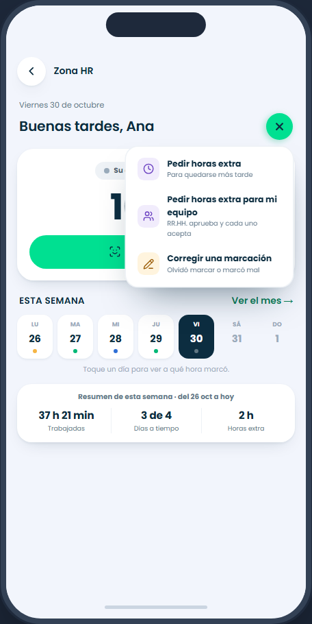
- 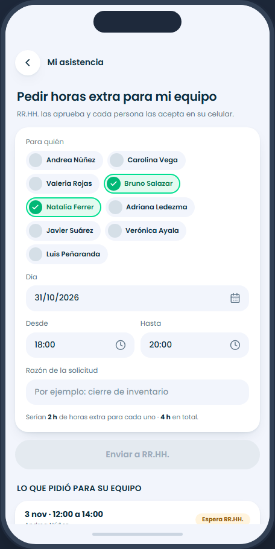
- 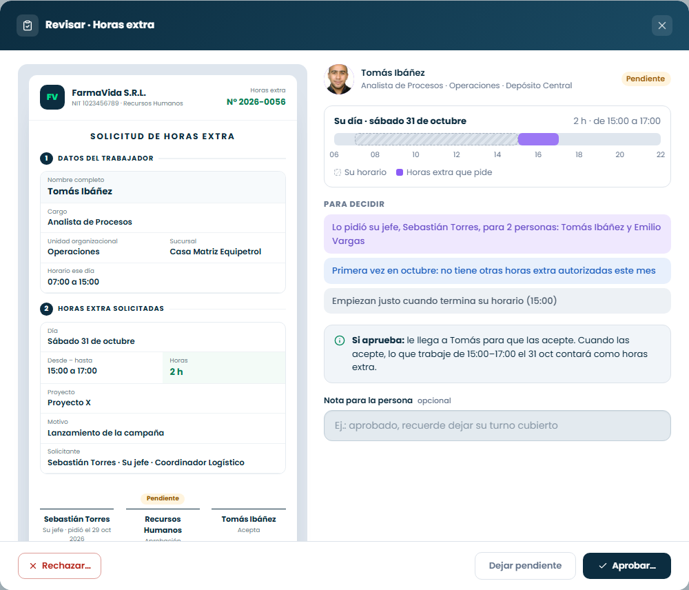

### CASO-ASI-27 · La tabla dice quién la pidió y para quién

- **Reglas:** BR‑ASI‑033 · W‑ASI‑12
- **Situación:** **Dado que** hay horas extra pedidas por la persona, por su jefe y asignadas por RR.HH. · **Cuando** RR.HH. mira la tabla · **Entonces** cada fila se lee como una frase: Solicitante → Para → cuándo.
- **Datos:** Álvaro Justiniano · «Para sí»; Sebastián Torres · «Su jefe · Coordinador Logístico» → Tomás Ibáñez; Ana Martínez Ruiz · «Su jefe · Líder de Marketing» → Andrea Núñez.
- **Calcula:** `solicitanteDe(x): la pidió la persona → «Para sí» · lider → su jefe y su cargo · asignacion → «RR.HH. · asignada»`
- **Para probarlo:** Solicitudes › Horas extra (Pendientes; con «Todas» se ven las asignadas).
- **En el código:** `data/asistenciaData.js › solicitanteDe()`, `pages/asistencia/HorasExtra.jsx` (la tabla).
- **Qué mirar:** ya no está la columna «Quién la originó»; en 1400 px entra el botón «Revisar» sin desplazar.
- 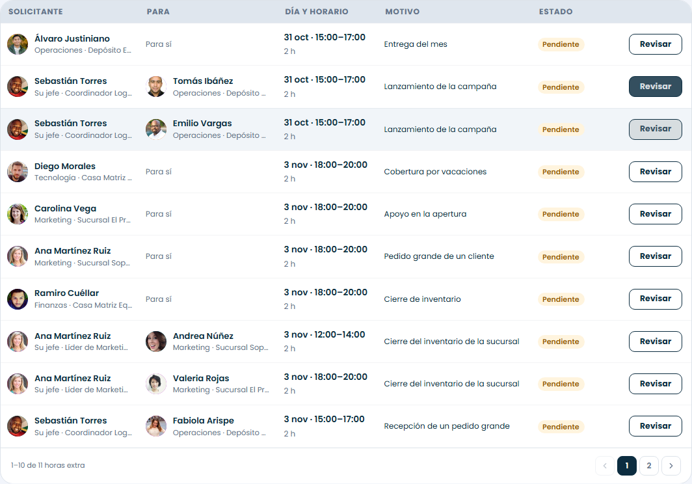

## 7 · Días sueltos

### CASO-ASI-28 · Pide vacaciones en días sueltos

- **Reglas:** BR‑ASI‑060, BR‑ASI‑041 · W‑ASI‑22, W‑ASI‑10
- **Situación:** **Dado que** Carlos quiere el 11 y el 16–17 de noviembre · **Cuando** toca esos días · **Entonces** sale **una** solicitud de 3 días hábiles y, al aprobarla, solo esos días quedan de vacaciones.
- **Datos:** celular: Carlos Mendoza Ríos toca 11, 16 y 17 nov. Web: Diego Morales pidió lun 26 y mié 28 oct (2 hábiles), saldo 15.
- **Calcula:** `se guarda { desde: 2026-10-26, hasta: 2026-10-28, dias: [2026-10-26, 2026-10-28] }`
  `días hábiles = los de la lista que son de trabajo = 2 · saldo después = 15 − 2 = 13`
  `¿el 27 está pedido? incluyeDia(s, 2026-10-27) = no → sigue siendo día de trabajo`
  `tramos (el fin de semana no corta): [11] y [16–17] → «mié 11 y lun 16 – mar 17 nov»`
- **Para probarlo:** celular: Mis solicitudes › «+» › Vacación. Web: Solicitudes › Vacaciones › Diego Morales; después de aprobar, su página › octubre.
- **En el código:** `hooks/useDiasElegidos.js`, `components/layout/VacacionPhone.jsx`, `data/asistenciaData.js › diasDeSolicitud(), incluyeDia(), tramosDias(), fechasDeDias(), textoDias()`.
- **Qué mirar:** el aro verde es el día en que vuelve; los días ámbar (ya pedidos) no se tocan; en el Libro, el 26 y el 28 dicen «Vacaciones» y el 27 queda normal.
- 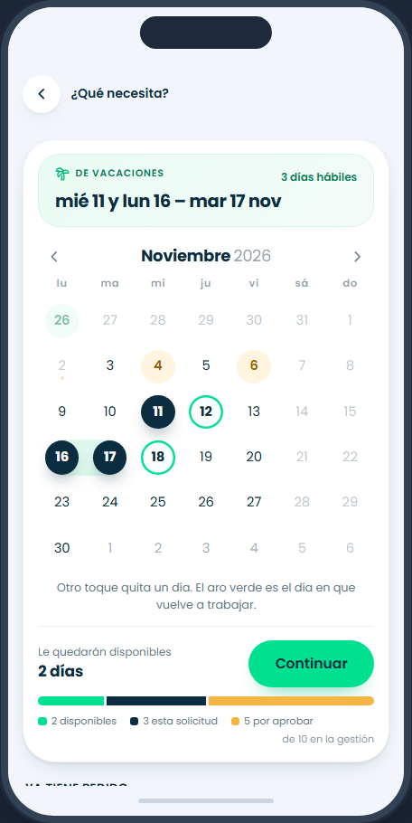
- 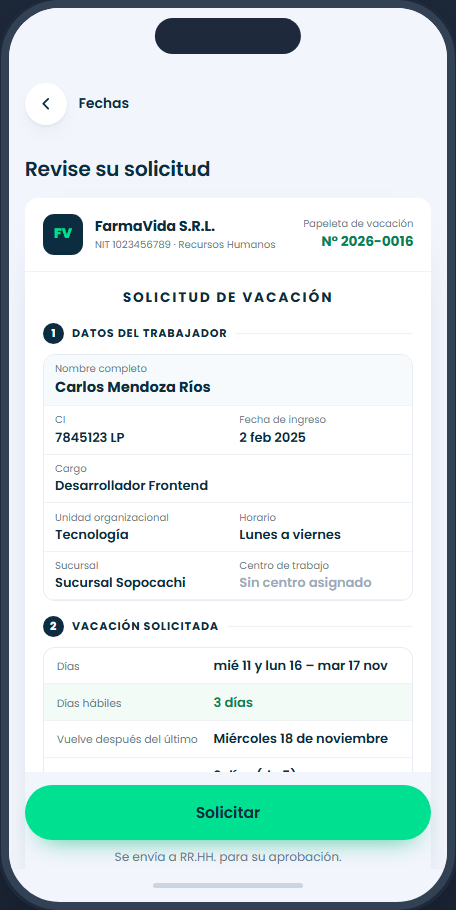
- 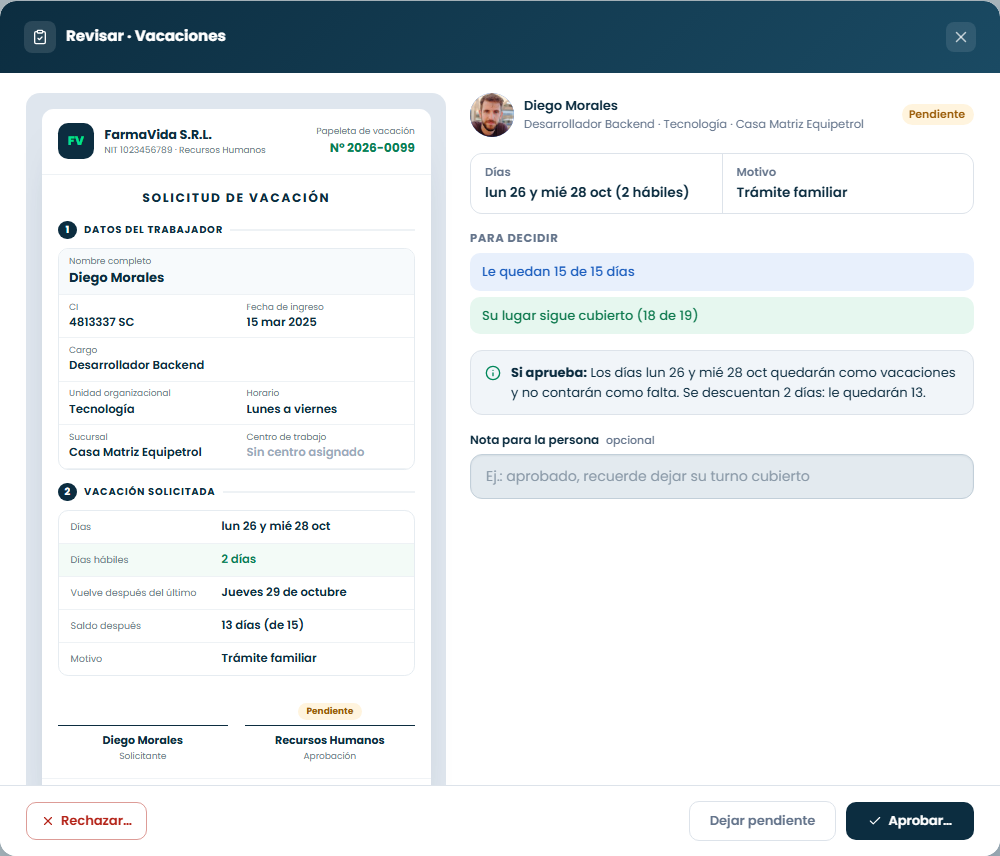
- 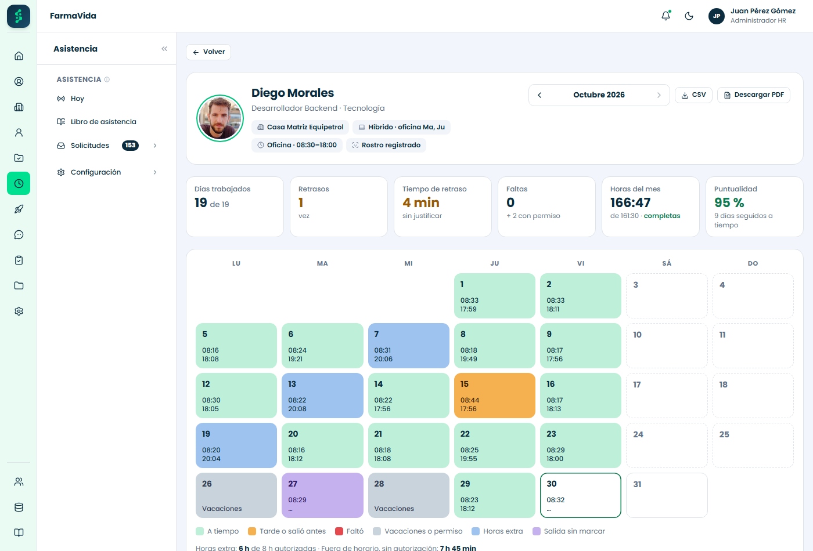

### CASO-ASI-29 · Marca y desmarca días de un permiso

- **Reglas:** BR‑ASI‑060 · W‑ASI‑22
- **Situación:** **Dado que** Carlos necesita permiso por un trámite · **Cuando** toca el 11, el 16, el 17 y otra vez el 16 · **Entonces** quedan el 11 y el 17: el segundo toque desmarca.
- **Datos:** Carlos Mendoza Ríos · Permiso · Trámite personal · toques: 11, 16, 17, 16.
- **Calcula:** `tocar(d): si ya está, se quita; si no, se agrega (si se puede elegir)`
  `arrastrar: agrega todo el tramo, saltando lo pasado, lo pedido y lo que no es de trabajo`
  `licencia de ley con días fijos: el primer toque pone todos sus días`
- **Para probarlo:** celular: Mis solicitudes › «+» › Permiso o licencia › Trámite personal (el calendario abre en el mes de hoy: pasar a noviembre).
- **En el código:** `hooks/useDiasElegidos.js`, `components/layout/PermisoPhone.jsx` (permiso y trabajo remoto).
- **Qué mirar:** ya no aparece «Es un permiso · No descuenta vacaciones» al pie; dice «Días de permiso · 2 días».
- 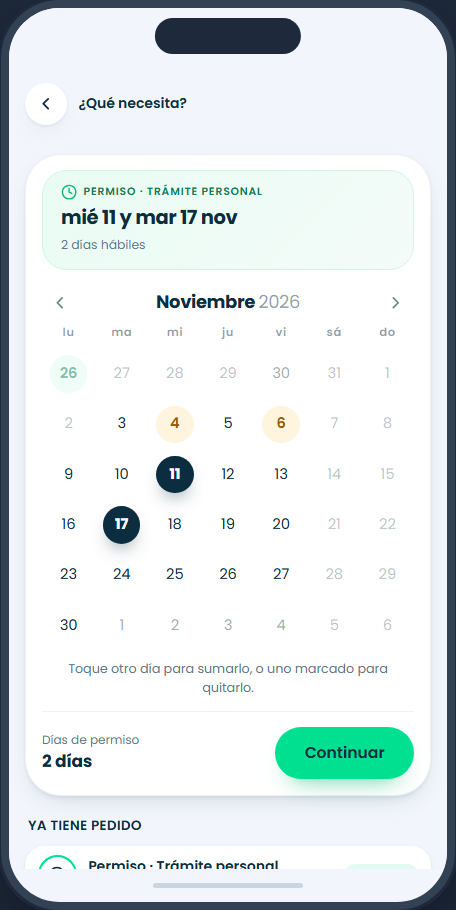

## 8 · Configuración

### CASO-ASI-30 · Un lugar sin ubicación

- **Reglas:** BR‑ASI‑003, BR‑ASI‑004 · W‑ASI‑18
- **Situación:** **Dado que** la Sucursal 16 de Julio no tiene punto en el mapa · **Cuando** RR.HH. abre Lugares · **Entonces** la ve en ámbar, «Nadie puede marcar aquí todavía», y la ubica ahí mismo; el mapa arranca en El Alto.
- **Datos:** Sucursal 16 de Julio · El Alto · sin geocerca · 0 personas; vecino ya ubicado: Depósito El Alto (radio 200 m).
- **Calcula:** `sin punto → «Sin ubicación» + «Nadie puede marcar aquí todavía» (o «N personas no pueden marcar aquí»)`
  `el mapa arranca en un lugar ya ubicado de la misma zona (sus centros, su sucursal o la misma ciudad), zoom 14`
- **Para probarlo:** Configuración › Lugares y geocercas › Sucursal 16 de Julio › «Ubicar en el mapa».
- **En el código:** `pages/asistencia/Configuracion.jsx › Lugares, ModalLugar`, `components/asistencia/MapaGeocerca.jsx` (`cerca`).
- **Qué mirar:** «1 marca aquí» en singular; el centro dice «Almacén», no «Centro de trabajo · Centro de trabajo». Organización no se toca.
- 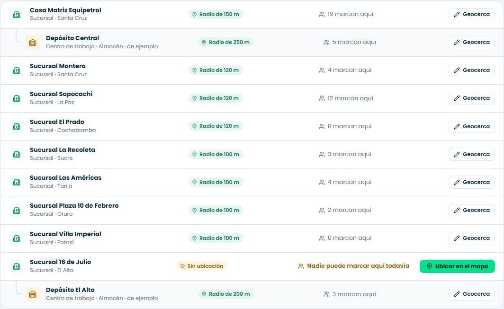
- 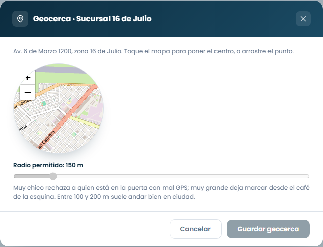

### CASO-ASI-31 · Un descanso de 2 horas

- **Reglas:** BR‑ASI‑014 · W‑ASI‑15
- **Situación:** **Dado que** la empresa tiene horario cortado, con almuerzo de 12:30 a 14:30 · **Cuando** RR.HH. escribe esas horas en el descanso · **Entonces** la tarjeta dice «Dura 2 h»: no hay atajos que hagan creer que el máximo es una hora.
- **Datos:** Nuevo horario 08:30–18:00 · descanso 12:30 → 14:30.
- **Calcula:** `dura = 14:30 − 12:30 = 2 h · si el hasta no es después del desde → aviso`
- **Para probarlo:** Configuración › Horarios › Nuevo horario › tocar el descanso.
- **En el código:** `pages/asistencia/Configuracion.jsx › TarjetaDescanso`, `components/asistencia/CampoHora.jsx`.
- **Qué mirar:** sin botones 15 · 30 · 45 min · 1 h; la barra muestra dónde cae el descanso en el día.
- 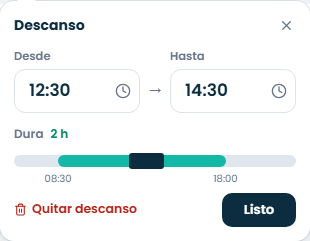
